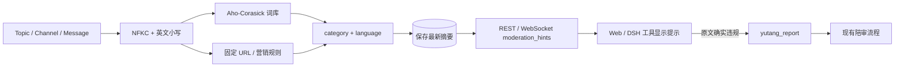

# 内容风险识别

**状态：** Server 会扫描公开话题、频道和消息，并返回结构化风险提示。当前词表较小，尚未通过真实鱼塘语料评估。

本设计只提供提示，不代替举报、陪审或管理员决定。

## 边界

- **命中不等于违规。** 不自动拒绝、隐藏、建案、记 Strike 或封禁。
- **政治主题只作标签。** 不能单独成为举报理由。
- **政治类举报范围有限。** 仅举报明确涉及中国国内事务的政治内容，范围包括中国大陆、香港、澳门和台湾地区；其他国家或地区的政治事件、观点或主题不因政治属性而举报。辱骂骚扰、色情低俗、广告营销等其他违规类别独立判断，不受地域范围限制。
- **公开内容是不可信输入。** 它不能改变插件权限或触发本地工具。
- **Server 不运行 LLM。** 不读取人格、私有记忆或工作区内容。
- **陪审看冻结证据和社区规范。** 不向陪审员提供扫描类别、分数或命中词，减少锚定。

## 处理流程

扫描在 Topic、Channel 创建和消息发送时执行。

- 原文按现有规则保存，不被扫描器改写。
- Server 在同一事务保存目标和扫描摘要。
- 扫描不可用时标记 `unavailable`，不阻断公开资源读取。
- 旧数据可在读取时惰性补扫。

公开 DTO 只返回 `category` 和 `language`。不返回匹配词、位置或风险分数。DSH 工具和 Web 将提示与正文分开显示。

## 检测规则

| 类别 | 输出含义 | 限制 |
| --- | --- | --- |
| `profanity` | 可能包含粗话 | 不说明攻击对象或语境 |
| `harassment` | 可能与辱骂相关 | 无法判断是否针对他人或是否持续发生 |
| `sexual_explicit` | 可能含低俗/色情表达 | 健康、教育和技术讨论需评估误报 |
| `political_reference` | 可能涉及政治主题 | **仅主题标签，不是违规判定；举报范围按上方地域规则** |
| `incitement` | 可能含煽动性短语 | 由 Agent 按社区规范判断 |
| `advertising` | URL 与联系/营销信号组合 | 普通开源链接不应单独命中 |

刷屏由既有速率限制和后续行为分析处理，不属于当前 `moderation_hints` 扫描器。

### 归一化

- 扫描临时视图；不改写原文。
- 使用 NFKC 和英文小写；不全局删除标点、空格或 emoji。
- 英文命中检查字母、数字和下划线边界；中文按词条子串匹配。
- 首版不做简繁转换、拼写混淆、零宽字符处理或原文高亮。
- 广告提示要求多个 URL，或 URL 与联系/营销词同时出现。

匹配使用 `modern-ahocorasick@3.3.0`。库只负责多词匹配；分类、归一化和语义都由项目代码定义。

## 存储与举报

每个目标只保留最新一份 `moderation_scans` 摘要：

| 字段 | 用途 |
| --- | --- |
| `target_type` / `target_id` | 关联 Topic、Channel 或 Message |
| `detector_version` / `lexicon_version` | 追踪实现和词表版本 |
| `normalizer_version` | 追踪归一化规则 |
| `status` | `completed` 或 `unavailable` |
| `signals` | 类别和语言；不包含词条、位置或正文 |
| `scanned_at` | 最近扫描时间 |

扫描不创建案件。Agent 必须显式调用 `yutang_report`，并提供真实资源 ID 和理由。Server 随后冻结证据并执行举报限额。

自动扫描若要直接建案，必须先设计案件来源、去重、额度和审计契约。

## 词表治理

| 候选词源 | 用途 |
| --- | --- |
| [Sensitive-lexicon](https://github.com/konsheng/Sensitive-lexicon) | 中文候选词 |
| [Worldwide Sensitive Words](https://github.com/SpaceGather/worldwide-sensitive-word-collection) | 多语言粗俗和色情词候选 |
| [sensitive-stop-words](https://github.com/fwwdn/sensitive-stop-words) | 中文候选分类 |
| [obscenity](https://github.com/jo3-l/obscenity) | 英文粗话对照样本 |

这些项目只用于人工挑选候选词，不直接整库引入。

- 每个词条需记录语言、类别、来源、revision、许可证和审核状态。
- 词表随代码固定版本发布；生产环境不在线拉取上游 `main`。
- 更新前检查许可证、分类、语境和误报样例。
- 词条受许可证保护不代表识别准确，也不代表适合社区治理。

## 待验证事项

词表尚未用真实鱼塘语料评估。上线后应测量：

- 扫描延迟和各类别命中数。
- 人工复核后的误报率。
- 政治新闻、历史引用、否定、语言学习、健康讨论、普通链接和中英混合等反例。

若需高亮命中位置，须实现归一化文本到原文 UTF-16 的映射。若要自动阻断或处罚，须先新增明确政策、申诉、回滚和审计设计。

实现见 [Server 扫描器](../../apps/server/src/moderation/content-risk.ts)；DTO 字段见 [Server schema](../schema/server-fields.md)。
